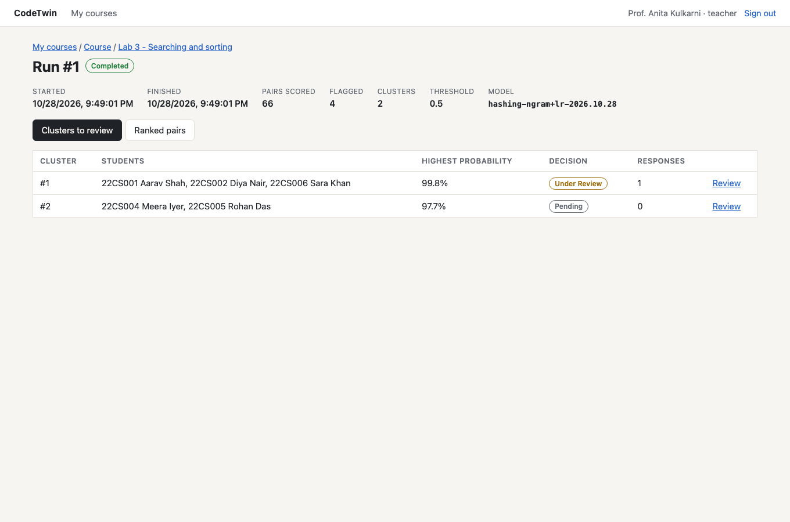
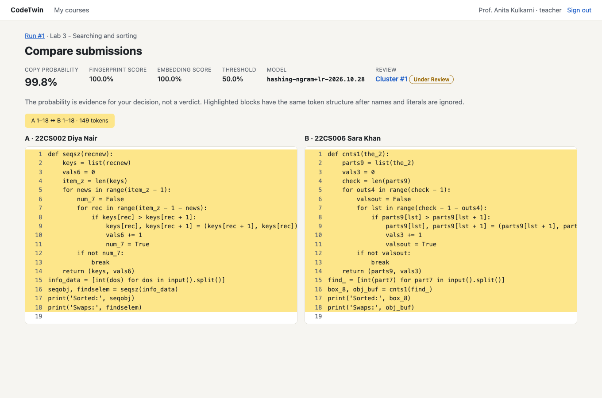
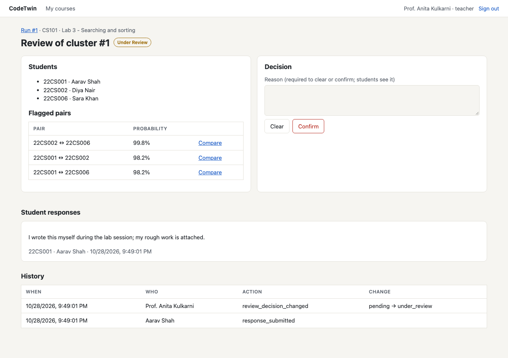
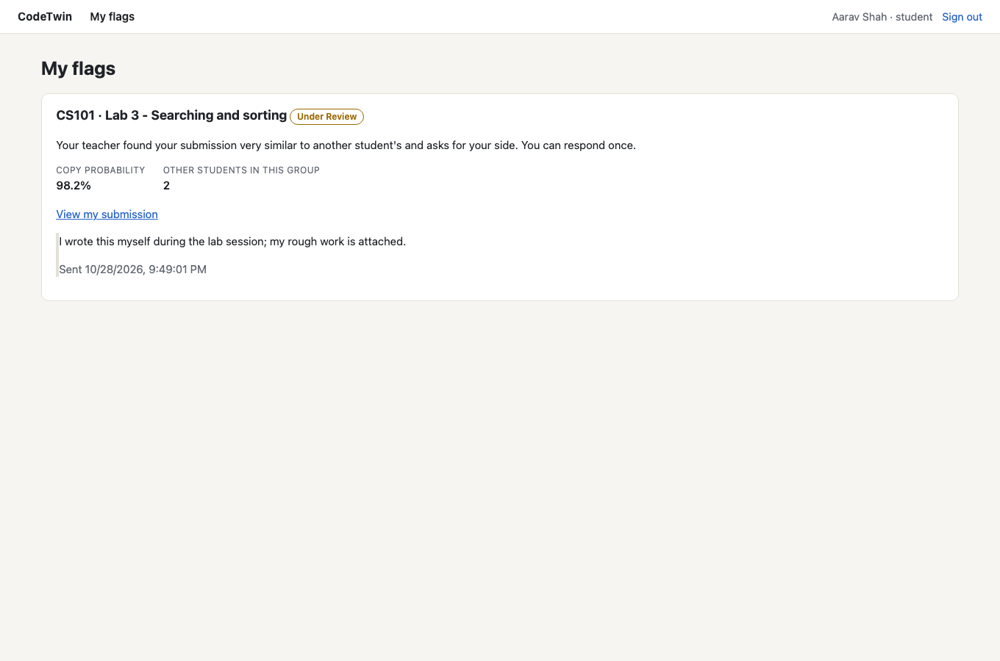

<div align="center">

# CodeTwin

**Find likely copied code in Python lab submissions, and run a fair review afterwards.**


</div>

A lab of 60 students produces 1,770 pairs of submissions, far too many to compare by eye, and a copy with renamed variables slips through.
Tools such as MOSS, JPlag and Dolos detect similar code. CodeTwin also covers what happens after detection:
an explained flag, a student response, a recorded decision, repeat-pair tracking and an append-only audit trail.

## Features

- **Two similarity methods.** Winnowed k-gram fingerprints (the technique behind MOSS) and UniXcoder code embeddings, combined by a trained logistic regression classifier into one copy probability.
- **Clusters, not just pairs.** Flagged pairs that share a submission become one review, so three students who shared one file get one case.
- **Side-by-side comparison.** Matched lines are highlighted, with both scores, the probability and the model version shown.
- **Fair review process.** The teacher opens, clears or confirms a review with a reason. Flagged students see it and can respond once, with evidence.
- **Repeat pairs.** Students flagged together in two or more assignments of a course.
- **Audit trail.** Every decision change is written by a database trigger to a log that cannot be updated or deleted.
- **Analytics.** Three SQL views feed a Power BI report: flagged pairs, review turnaround and repeat pairs.

## Architecture


The browser never reaches a data store directly; every request goes through the API, which checks role and ownership.
Similarity runs are queued and scored by a separate worker, never inside a web request.

| Layer | Choice |
|---|---|
| Frontend | React (Vite) on Azure Static Web Apps |
| Backend | FastAPI on Azure App Service |
| Background work | Azure Storage Queue and a worker process (same codebase as the API) |
| AI/ML | UniXcoder embeddings and a scikit-learn logistic regression classifier |
| Relational data | Azure SQL Database: 13 tables in 3NF, 3 views, 2 procedures, 2 triggers |
| Files / documents | Azure Blob Storage (source files) and Cosmos DB (match reports) |
| Secrets | Azure Key Vault through managed identity |
| Analytics | Power BI on three SQL views |

## Screenshots

| Clusters to review | Side-by-side comparison |
|---|---|
|  |  |
| **Review decision** | **Student view of a flag** |
|  |  |

All 13 screens are in [docs/screenshots](docs/screenshots).

## How detection works

1. **Normalise:** tokenise each file and replace identifiers and literals, so renaming and reformatting make no difference.
2. **Fingerprint:** hash every 5-token run, keep a subset by winnowing, and score the overlap. Starter code is excluded.
3. **Embed:** UniXcoder turns each file into a vector; the score is the cosine similarity.
4. **Classify:** logistic regression turns the two scores into a copy probability; a pair is flagged at the run's threshold.
5. **Cluster** the flagged pairs, then **explain** each one with its matched line ranges.

Results on the labelled set (885 pairs, 5-fold cross-validation):

| Metric | Value |
|---|---|
| Precision | 1.00 |
| Recall | 0.91 (every unchanged, renamed, reordered and restructured copy; 57% of partial copies) |
| 60-file run (1,770 pairs) | 3.2 s on a laptop CPU, against a 5-minute target |

The copies in this set are machine-made, so these numbers stay provisional until testing on real submissions. A probability is evidence for the teacher, never a verdict. Details: [docs/REPORT.md](docs/REPORT.md#6-aiml-the-similarity-pipeline).

## Project status

CodeTwin is nearly complete: all 11 functional requirements work end to end and are covered by 40 automated tests.
The remaining items below are planned for completion within a week.

| Area | Done | Remaining (within a week) |
|---|---|---|
| **Azure** | Code for every Azure service; setup script in `infra/` | Run the script, deploy, smoke-test on Azure |
| **RDBMS** | Schema, indexes, views, procedures and triggers; tested on the SQLite port | Run the T-SQL on Azure SQL; create the app and report database users |
| **System design** | API, queue and worker; 29 endpoints; ML pipeline and classifier | Measure speed on App Service; build the Power BI report |
| **Security** | Argon2id, short-lived tokens, lockout, role and ownership checks, upload limits, CSP | Firewall rule on Azure; threat model and security checklist |

Testing on real lab submissions follows once their use is approved. Full list: [docs/REPORT.md](docs/REPORT.md#10-remaining-work).

## Getting started

Runs locally without Azure: SQLite and folders under `data/` stand in for Azure SQL, Blob Storage, Cosmos DB and the queue.

**Backend** (Python 3.12)

```bash
python3.12 -m venv .venv && source .venv/bin/activate
pip install -r backend/requirements.txt
cd backend
python -m pytest -q                       # 40 tests
python -m codetwin.cli seed-demo          # demo course: 12 students, two assignments, runs done
uvicorn codetwin.api.main:app --reload    # API on :8000, interactive docs at /docs
python -m codetwin.worker                 # second terminal: processes new runs
```

**Frontend** (Node 20+)

```bash
cd frontend && npm install && npm run dev # http://localhost:5173
```

**Demo accounts** (password `codetwin-demo-1`): `admin@demo.edu`, `teacher@demo.edu`, `student1@demo.edu` … `student12@demo.edu`.
Student 1 has an open flag on Lab 3 with a response; 22CS001 and 22CS002 are a repeat pair.

<details>
<summary><b>Use the UniXcoder model</b></summary>

The default embedder (`hashing`) needs no download. To use UniXcoder, as in the design:

```bash
pip install -r backend/requirements-ml.txt    # torch + transformers; ~500 MB of weights on first use
export CODETWIN_EMBEDDER=unixcoder            # set for both the API and the worker
```

</details>

<details>
<summary><b>Retrain the classifier</b></summary>

```bash
python ml/make_dataset.py                     # regenerate the 150 copies from the 30 originals
python ml/train.py --embedder hashing         # or unixcoder; writes the model JSON and ml/results/metrics_*.json
python ml/benchmark.py --embedder unixcoder   # time a 60- and 120-file run
```

</details>

<details>
<summary><b>Upload format</b></summary>

One `.zip` per assignment with one `.py` file per student, named by roll number: `22CS014.py`, `22CS014_lab3.py` or `22CS014/main.py`.
Files from students not enrolled in the course, non-`.py` files, files over 512 KB, non-UTF-8 files and second files for the same student are rejected with a reason.
Hidden files, `__MACOSX` and any path containing `..` are ignored. Uploaded code is only tokenised and embedded; it is never imported or run.

</details>

## Deploy to Azure

[infra/azure_setup.sh](infra/azure_setup.sh) creates the resource group, Azure SQL, storage (private container and queue), Cosmos DB, Key Vault, and the App Service apps for the API and worker with managed identities.
It has not yet been run against a subscription; see section 9 of the [report](docs/REPORT.md#9-azure-deployment). Power BI setup: [docs/POWERBI.md](docs/POWERBI.md).

## Repository layout

```
frontend/              React app: teacher, student and admin screens
backend/codetwin/      one Python package: the API (codetwin.api) and the worker (codetwin.worker)
  similarity/          normalise → fingerprint → embed → classify → cluster → explain
backend/tests/         40 pytest tests: API, roles, review flow, pipeline, integrity
db/                    codetwin_schema.sql (Azure SQL) and schema_sqlite.sql (local port)
ml/                    labelled set, copy generator, training, benchmark, results
infra/                 az CLI setup script
docs/                  build report, Power BI guide, architecture diagram, screenshots
```

## Documentation

- [Build report](docs/REPORT.md): status by requirement, results, security controls, testing, remaining work
- [Power BI guide](docs/POWERBI.md): connecting the report to the three views
- [Architecture diagram source](docs/diagrams/make_architecture.py): run it to regenerate the SVG

## Credits

- **Prior work:** MOSS, JPlag, Dolos
- **Technique:** k-gram fingerprinting with winnowing (Schleimer, Wilkerson and Aiken, 2003)
- **Model:** microsoft/unixcoder-base
- **Libraries:** React, FastAPI, scikit-learn, Hugging Face Transformers
- **AI assistance:** Claude was used to shape the idea, draft the design document and schema, and write much of this code; see the report.
