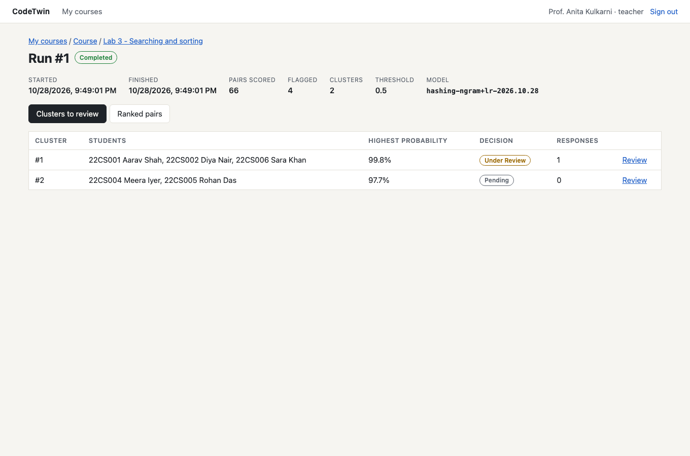
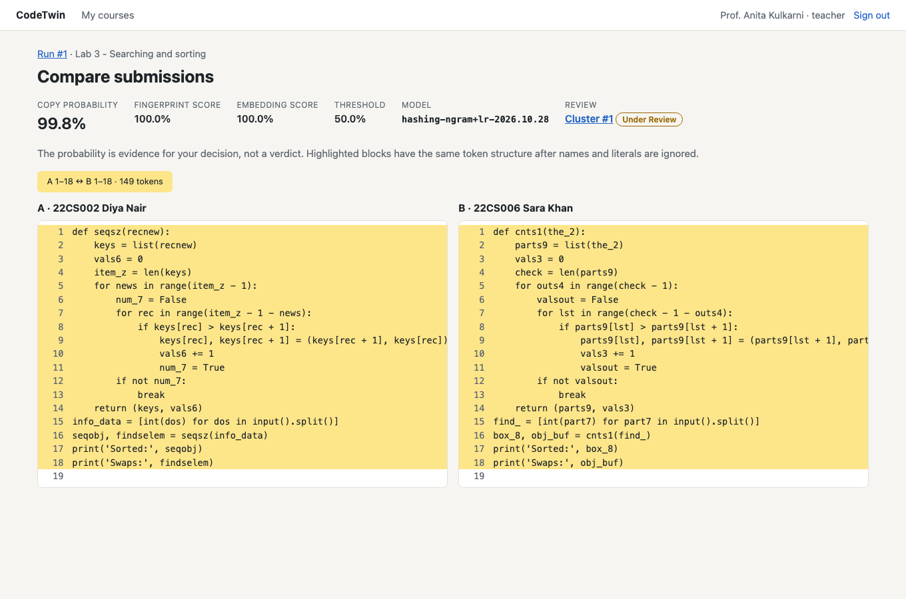
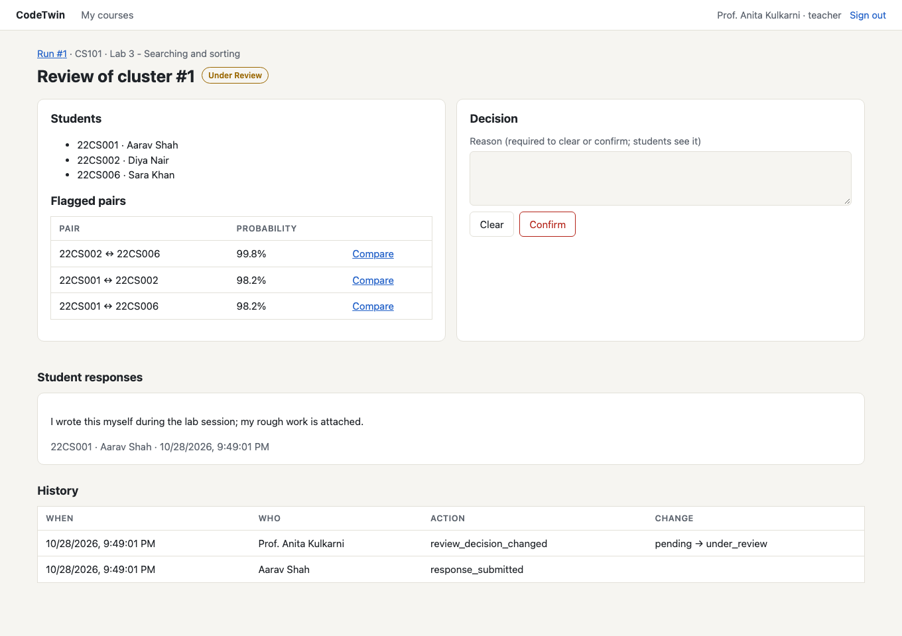
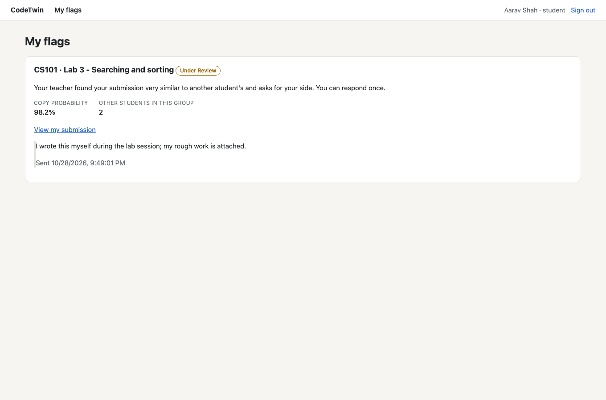
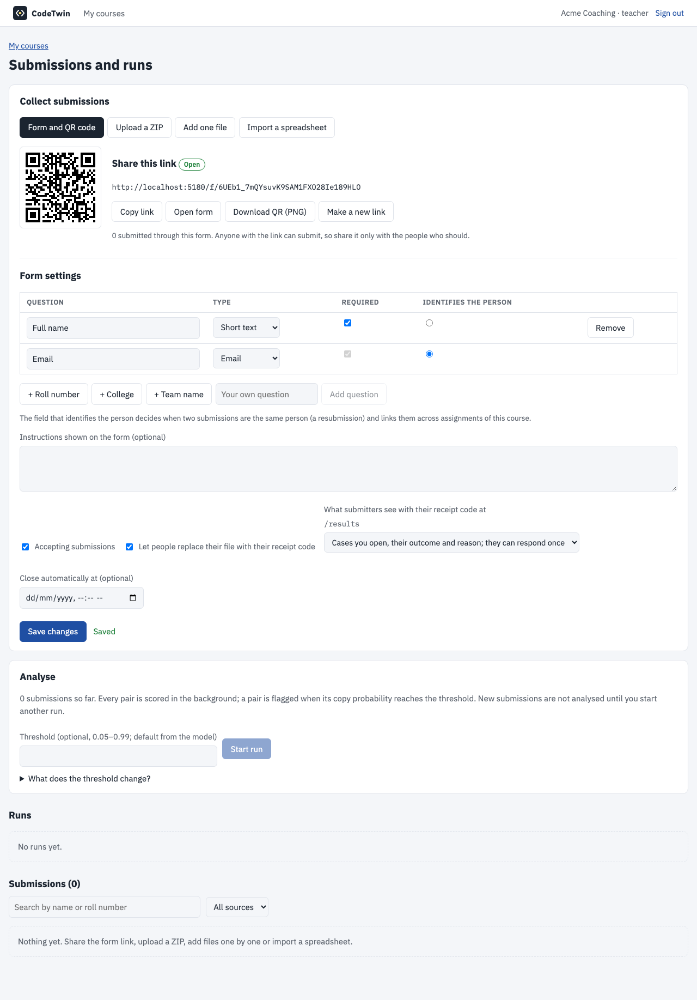
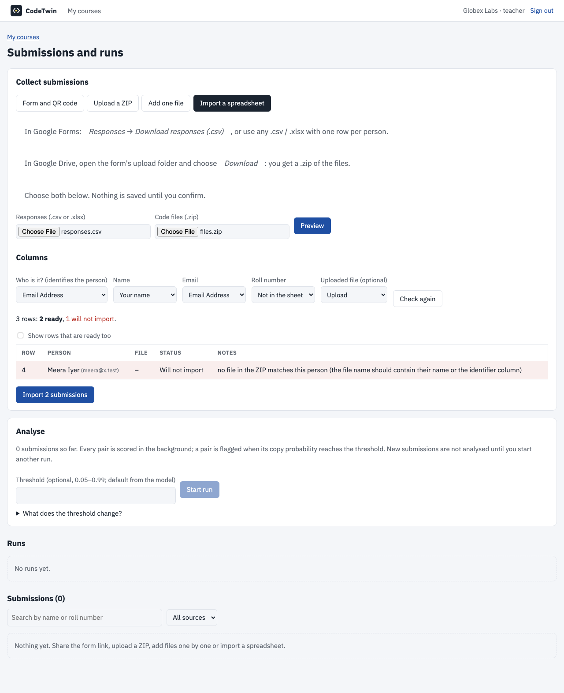
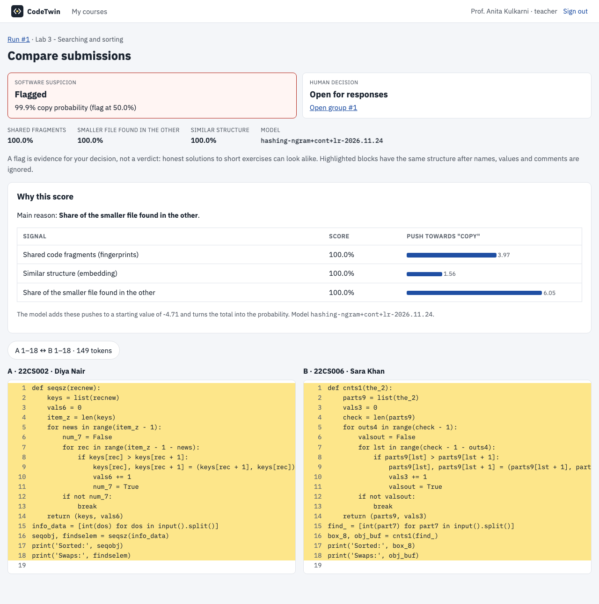
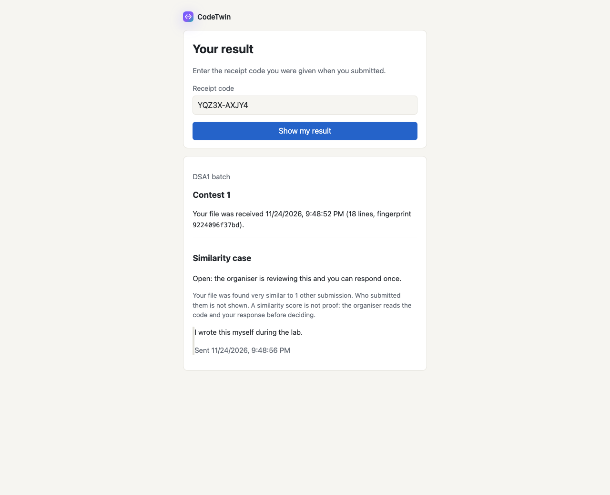

<div align="center">

# CodeTwin

**Find likely copied code in Python submissions, show the evidence, and run a fair review afterwards.**


</div>

A lab of 60 students produces 1,770 pairs of submissions, far too many to compare by eye, and a copy with renamed variables slips through.
Tools such as MOSS, JPlag and Dolos detect similar code. CodeTwin covers the whole workflow around detection:

**collect code → analyse → show the evidence → review the case → record a decision → tell each person their own result.**

## Features

**For teachers, instructors and contest organisers (customers)**

- **Sign up and start.** Create your own courses or batches. No administrator has to set anything up, and nobody else sees your data.
- **Four ways to collect code:**
  - a **submission form** with fields you choose (name, email, roll number, college, team, your own questions), shared as a link or **QR code**
  - a ZIP upload, matched by roll number or by file and folder names
  - adding files one at a time
  - **importing a spreadsheet plus a ZIP of the files**, such as a Google Forms export, with a preview of every row before anything is saved
- **Explained results.**
  - Side-by-side comparison with matched lines highlighted.
  - Three scores, plus *why* the model flagged a pair.
  - Notes on files whose scores are less reliable (very short, not valid Python, mostly starter code).
  - Downloadable reports: CSV of every pair, and printable HTML with the matched code.
- **Fair review.** Flagged pairs that share a person become one case. You open it, people respond once with optional evidence, and you clear or confirm it with a reason. The software's suspicion and your decision are always shown separately.
- **Repeat pairs** across assignments of a course, and an **audit trail** that cannot be edited or deleted.

**For people who submit**

- No account needed. Submitting through a form gives a **receipt code**. The code is needed to replace your file, so nobody else can overwrite it, and to see your result at `/results`.
- You see only your own case: its status, outcome and reason, and (if the organiser allows) your own code with the matched lines marked. **Never another person's name, email, roll number or code.**
- College courses still work as designed: students with accounts see their flags under *My flags*.

**For the platform admin**

- Health of the API, database, queue, worker and storage; API errors and response times; failing runs.
- Customers and their usage, security counts, suspending and restoring accounts, and the audit log. The admin never sees submitted code.

## Architecture


The browser never reaches a data store directly: every request goes through the API, which checks role and ownership.
Similarity runs are queued and scored by a separate worker, never inside a web request.

| Layer | Choice |
|---|---|
| Frontend | React (Vite) on Azure Static Web Apps |
| Backend | FastAPI on Azure App Service, 49 endpoints |
| Background work | Azure Storage Queue and a worker process (same codebase as the API), with a heartbeat so a stuck run can be retried |
| AI/ML | UniXcoder embeddings and a scikit-learn logistic regression classifier |
| Relational data | Azure SQL Database: 15 tables in 3NF, 5 views, 2 procedures, 2 triggers, 20 indexes |
| Files / documents | Azure Blob Storage (source files, stored by content) and Cosmos DB (match reports) |
| Secrets | Azure Key Vault through managed identity |
| Analytics | Power BI on four SQL views, through a read-only user |

## Screenshots

| Clusters to review | Side-by-side comparison |
|---|---|
|  |  |
| **Review decision** | **Student view of a flag** |
|  |  |

| **Form, link and QR code** | **Import preview (Google Forms export)** |
|---|---|
|  |  |
| **Why a pair was flagged** | **A submitter's own result** |
|  |  |

Every screen is in [docs/screenshots](docs/screenshots). Screenshots 14–19 are taken by the browser tests (`SCREENSHOTS=1 npm run test:e2e`).

## How detection works

1. **Normalise:** tokenise each file and replace identifiers and literals, so renaming and reformatting make no difference.
2. **Fingerprint:** hash every 5-token run and keep a subset by winnowing. Starter code is excluded.
3. **Score** each pair three ways:
   - *shared fragments*: Jaccard overlap of the fingerprints
   - *containment*: the share of the smaller file found in the other, which catches a block copied into a larger file
   - *structure*: cosine similarity of the code embeddings
4. **Classify:** logistic regression turns the scores into a copy probability; a pair is flagged at the run's threshold.
5. **Cluster** the flagged pairs, then **explain** each one: matched line ranges, the contribution of each score, and notes on unreliable files.

Results on the labelled set (885 pairs; 5-fold cross-validation **grouped by problem**, so the model is always tested on exercises it never saw):

| Metric | Value |
|---|---|
| Precision | 1.00 (no honest pair flagged at threshold 0.5) |
| Recall | 0.93 (every unchanged, renamed, reordered and restructured copy; 63% of partial copies) |
| 60-file run (1,770 pairs) | 3.5 s with UniXcoder on a laptop CPU, against a 5-minute target |
| Pages under load | 95% of requests under 1.3 s with 100 users at once (target 2 s); `ml/load_test.py` |

**These numbers are synthetic.** The copies are machine-made from 30 hand-written solutions, so they show what the method can separate, not how it does on real students. Lowering the threshold catches more partial copies at the cost of false flags. The app shows that trade-off when you choose a threshold. A probability is evidence for a human decision, never a verdict. Details: [docs/REPORT.md](docs/REPORT.md#6-aiml-the-similarity-pipeline), section 6.7 for the latest model.

**AI-written code is not checked.** Existing detectors are not reliable enough on short lab code to put a flag on a student. See [docs/AI_ANALYSIS_PLAN.md](docs/AI_ANALYSIS_PLAN.md) for the evidence and the test such a feature would have to pass.

## Project status

Everything runs end to end locally and is tested three ways, all in CI:
136 API tests on SQLite, the same suite on SQL Server 2022 (plus T-SQL schema, migration, behaviour and database-permission checks), and 15 browser tests in Chromium. Nothing is deployed yet.

| Area | Done | Remaining |
|---|---|---|
| **Product** | Self-service customers, forms and QR codes, imports, explained results, reports, participant results and responses, admin monitoring; browser-tested | — |
| **RDBMS** | Schema, 7 migrations, 5 views, procedures and triggers, least-privilege database users; all tested on SQL Server 2022 and the SQLite port | Run them on the Azure SQL database once it exists |
| **ML** | Three-score models for both embedders, grouped cross-validation, per-threshold trade-offs | Test on real, approved submissions |
| **Azure** | Code for every service; setup script in `infra/`; Power BI guide for four views | Run the script, deploy, smoke-test, firewall rule, build the Power BI file |
| **Security** | Argon2id, short-lived tokens, lockout, ownership checks on every endpoint, receipt codes, upload limits, CSP, proxy-aware rate limits; reviewed for this release; [threat model](docs/THREAT_MODEL.md) and [security checklist](docs/SECURITY_CHECKLIST.md) | Penetration test once deployed |

## Getting started

Runs locally without Azure: SQLite and folders under `data/` stand in for Azure SQL, Blob Storage, Cosmos DB and the queue.
Older local databases are migrated automatically at start-up, with a backup of the database file first.

**Backend** (Python 3.12)

```bash
python3.12 -m venv .venv && source .venv/bin/activate
pip install -r backend/requirements.txt
cd backend
python -m pytest -q                       # 136 tests
python -m codetwin.cli seed-demo          # demo course: 12 students, two assignments, runs done
uvicorn codetwin.api.main:app --reload    # API on :8000, interactive docs at /docs
python -m codetwin.worker                 # second terminal: processes new runs
```

**Frontend** (Node 20+)

```bash
cd frontend && npm install && npm run dev # http://localhost:5173
npx playwright install chromium && npm run test:e2e   # browser tests; they start their own servers and data
```

**SQL Server** (Docker): `db/tests/run_sqlserver.sh` checks the T-SQL schema, the migrations and the procedures; `db/tests/run_api_on_sqlserver.sh` runs the whole API suite on SQL Server 2022.

**Demo accounts** (password `codetwin-demo-1`): `admin@demo.edu`, `teacher@demo.edu`, `student1@demo.edu` … `student12@demo.edu`.
Student 1 has an open flag on Lab 3 with a response; 22CS001 and 22CS002 are a repeat pair.
To try the self-service side, create a customer account at `/signup`.

Settings are environment variables prefixed `CODETWIN_`; every one is listed with its purpose in [.env.example](.env.example).

<details>
<summary><b>Use the UniXcoder model</b></summary>

The default embedder (`hashing`) needs no download. To use UniXcoder, as in the design:

```bash
pip install -r backend/requirements-ml.txt    # torch + transformers; ~500 MB of weights on first use
export CODETWIN_EMBEDDER=unixcoder            # set for both the API and the worker
```

</details>

<details>
<summary><b>Retrain and measure</b></summary>

```bash
python ml/make_dataset.py                     # regenerate the 150 copies from the 30 originals
python ml/train.py --embedder hashing         # or unixcoder; --features 2 for the original two-score model
python ml/benchmark.py --embedder unixcoder   # time a 60- and 120-file run
python ml/load_test.py --users 100           # page response times under load, against a running API
```

Training writes the model JSON (with its measured operating points) and `ml/results/metrics_*.json`. Retired models are kept in `backend/codetwin/similarity/models/archive/`, so older runs can still be explained.

</details>

<details>
<summary><b>Upload and import formats</b></summary>

- **ZIP, by roll number** (college courses): one `.py` file per student, named `22CS014.py`, `22CS014_lab3.py` or `22CS014/main.py`.
- **ZIP, by name:** each folder (`Aarav Shah/main.py`) or loose file (`Team 7.py`) is one person.
- **Spreadsheet + ZIP:** a `.csv` or `.xlsx` with one row per person, plus a ZIP of the files. Each row is matched to the file whose name contains the person's name, email or roll number, or whose name is in a file column. From Google Forms:
  1. Responses → Download responses.
  2. Download the form's upload folder from Google Drive as a ZIP.

Non-`.py` files, files over 512 KB, empty or non-UTF-8 files and second files for one person are rejected with a reason. Hidden files and `__MACOSX` are ignored, and names in an archive are never used as paths. Uploaded code is only tokenised and embedded; it is never imported or run.

</details>

## Deploy to Azure

[infra/azure_setup.sh](infra/azure_setup.sh) creates the resource group, Azure SQL, storage (private container and queue), Cosmos DB, Key Vault, and the App Service apps for the API and worker with managed identities.
It has not yet been run against a subscription; see section 9 of the [report](docs/REPORT.md#9-azure-deployment).
A fresh database uses [db/codetwin_schema.sql](db/codetwin_schema.sql). A database created from an earlier version is updated with [db/migrations](db/migrations), as described in [docs/MIGRATION_PLAN.md](docs/MIGRATION_PLAN.md).
Power BI setup: [docs/POWERBI.md](docs/POWERBI.md).

## Repository layout

```
frontend/              React app: landing page, customer, student, admin, public form and results pages
backend/codetwin/      one Python package: the API (codetwin.api) and the worker (codetwin.worker)
  similarity/          normalise → fingerprint → embed → classify → cluster → explain
  intake.py            the shared checks and storage for every way code comes in
  results.py           what a person may see about their own case
backend/tests/         136 pytest tests: API, roles, isolation between customers, privacy, forms, imports, reports
frontend/e2e/          browser tests (Playwright)
db/                    codetwin_schema.sql (Azure SQL), schema_sqlite.sql (local port), migrations/, tests/ (SQL Server checks)
ml/                    labelled set, copy generator, training, benchmark, load test, results
infra/                 az CLI setup script
docs/                  build report, plans, Power BI guide, architecture diagram, screenshots
```

## Documentation

- [Demo guide](docs/DEMO_GUIDE.md): showing the whole flow step by step (in Hinglish), with the demo files in [docs/demo-kit](docs/demo-kit)
- [Build report](docs/REPORT.md): status by requirement, results, security controls, testing, remaining work
- [Customers, participants and migrations](docs/MIGRATION_PLAN.md): account model, data model changes, forms, imports, privacy rules
- [AI-generated code analysis](docs/AI_ANALYSIS_PLAN.md): why it is not offered, and the test it would have to pass
- [Threat model](docs/THREAT_MODEL.md): assets, actors, 20 threats with their controls and tests, accepted risks
- [Security checklist](docs/SECURITY_CHECKLIST.md): every control, its status and where it is checked
- [Power BI guide](docs/POWERBI.md): connecting the report to the four views, and keeping names private
- [Architecture diagram source](docs/diagrams/make_architecture.py): run it to regenerate the SVG

## Credits

- **Prior work:** MOSS, JPlag, Dolos
- **Technique:** k-gram fingerprinting with winnowing (Schleimer, Wilkerson and Aiken, 2003)
- **Model:** microsoft/unixcoder-base
- **Libraries:** React, FastAPI, scikit-learn, Hugging Face Transformers, openpyxl, node-qrcode
- **AI assistance:** Claude was used to shape the idea, draft the design document and schema, and write much of this code; see the report.
