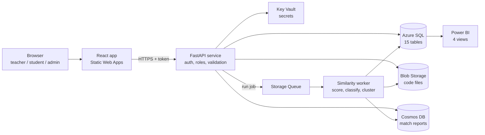
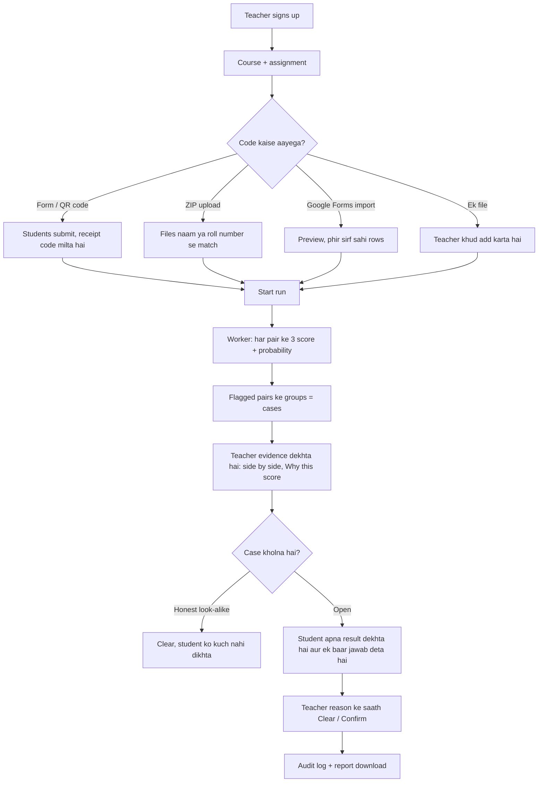
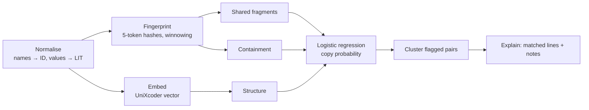

# CodeTwin demo guide

Sir ya kisi ko bhi CodeTwin ka poora flow dikhane ke liye: pehle project ka idea, phir tayaari, phir har step par **kya click karna hai, kya bolna hai, aur screen par kya dikhega.** Poora demo lagbhag 12 minute ka hai.

**Is guide mein:** [Presentation ke 7 hisse](#presentation-ke-7-hisse-kya-taiyaar-rakhna-hai) · [Tech stack aur kyun](#tech-stack-aur-kyun-use-kiya) · [Tayaari](#part-1-demo-se-10-minute-pehle-tayaari) · [Demo ke 12 steps](#part-2-demo-ke-12-steps) · [Login](#login-ka-saar-ek-nazar-mein) · [Sawaal-jawab](#sawaal-aur-chhote-jawab) · [Gadbad ho toh](#agar-kuch-gadbad-ho)

**Saath mein kaam aane wale links**

| Kya | Link |
|---|---|
| Demo script, har step ke screenshot ke saath (online page) | https://claude.ai/artifact/A2tw92Jcjua3o4M83LL6SX |
| Saari 25 screens ki gallery | https://claude.ai/artifact/3HH8w87SHWnqbGxDSVzKgP |
| Demo ki saari files | [docs/demo-kit/](demo-kit/) ([kaun si file kis step ki](demo-kit/README.md)) |
| Project ka README | [README.md](../README.md) |
| Build report (results, architecture, testing) | [REPORT.md](REPORT.md) |
| Threat model (security) | [THREAT_MODEL.md](THREAT_MODEL.md) |
| Security checklist | [SECURITY_CHECKLIST.md](SECURITY_CHECKLIST.md) |
| AI-written code kyun check nahi karte | [AI_ANALYSIS_PLAN.md](AI_ANALYSIS_PLAN.md) |
| Customers, forms, imports aur database changes | [MIGRATION_PLAN.md](MIGRATION_PLAN.md) |
| Power BI report | [POWERBI.md](POWERBI.md) |

Dono online pages (claude.ai links) abhi **private** hain. Kisi aur ko dikhane ke liye page par **Share** button se share karna hoga.

---

## Pehle samjho: CodeTwin karta kya hai?

Socho ek lab mein 60 students ne Python assignment submit kiya. Teacher ko check karna hai ki kisne kisse copy kiya. 60 students ke **1,770 pairs** bante hain, jo haath se compare karna namumkin hai. Aur agar student ne sirf variable names badal diye, toh copy dikhti bhi nahi.

CodeTwin teen kaam karta hai:

1. **Code collect karta hai:** form link / QR code, ZIP upload, ya Google Forms import se.
2. **Har pair compare karta hai:** names hata kar structure dekhta hai, aur batata hai kaun se pair copy lagte hain, aur **kyun**.
3. **Fair review karata hai:** student ko apni baat rakhne ka mauka milta hai, teacher reason ke saath decision leta hai, aur sab record hota hai.

---

## Presentation ke 7 hisse: kya taiyaar rakhna hai

Presentation mein in 7 cheezon par dhyan diya jaayega. Har hisse ke liye: kya bolna/dikhana hai, aur uska jawab project mein kahan hai.

### ⓵ Project Idea: problem aur solution

**Problem:** 60 students ki lab mein 1,770 pairs bante hain, haath se compare nahi ho sakte. Variable names badalne se copy chhup jaati hai. Aur jo tools copy dhoondhte bhi hain (MOSS, JPlag, Dolos), wo uske baad ka kaam nahi karte: student ki baat sunna, reason ke saath faisla, record rakhna.

**Solution:** CodeTwin poora workflow sambhalta hai:

> Code collect karo → analyse karo → saboot dikhao → case review karo → faisla record karo → har insaan ko sirf apna result dikhao

**Kya alag hai:** samjhaya hua flag ("Why this score"), student ka jawab, teacher ka reason ke saath faisla, repeat pairs, audit log jo edit nahi ho sakta, aur bina account ke submission (form / QR code).

**Kahan hai:** [README](../README.md), [REPORT.md section 1](REPORT.md), original design document.

### ⓶ Design: architecture, flowcharts, UI/UX

**System architecture.** Browser kabhi seedha database tak nahi jaata. Har request API se hoke jaati hai, jo role aur ownership check karti hai. Bhaari comparison ek alag worker karta hai, queue ke through.



Poster jaisi diagram: [docs/diagrams/architecture-3d.svg](diagrams/architecture-3d.svg).

**User flow (flowchart):**



**Similarity pipeline:**



**UI/UX:** "paper aur ink" design, jaise examiner ki desk: answer-sheet jaisa kaagaz, blue-black ink, buttons ke liye ballpoint blue, laal sirf flag ke liye, aur milte code ke liye highlighter peela. Har screen par loading, empty aur error states hain; phone par form aur result page theek dikhte hain. Saari screens: [gallery](https://claude.ai/artifact/3HH8w87SHWnqbGxDSVzKgP), [docs/screenshots](screenshots/).

**Database design:** 15 tables (3NF), 5 views, 2 stored procedures, 2 triggers. [db/codetwin_schema.sql](../db/codetwin_schema.sql), [REPORT.md section 5](REPORT.md), [MIGRATION_PLAN.md](MIGRATION_PLAN.md).

### ⓷ Implementation: technologies aur kaise bana

Technologies aur unhe kyun chuna: neeche **[Tech stack aur kyun use kiya](#tech-stack-aur-kyun-use-kiya)** section dekho.

**Kaise bana (order mein):**
1. Design document: requirements (FR1–FR11), architecture, database, security.
2. Database schema aur login, roles.
3. Upload, fingerprint similarity, side-by-side view.
4. Embeddings, classifier training, clustering, review flow, audit log.
5. Self-service: customers, forms + QR code, imports, participant results.
6. Testing: API tests, SQL Server tests, browser tests, load test, security review.

**Local vs Azure:** laptop par SQLite aur folders, Azure SQL, Blob, Cosmos aur Queue ki jagah lete hain. Ek hi code dono par chalta hai ([stores.py](../backend/codetwin/stores.py), [db.py](../backend/codetwin/db.py)). Isliye poora system bina Azure ke chalta aur test hota hai.

### ⓸ Functionality: saare features ka demo

Ye neeche ke **Part 2 (12 steps)** mein hai. Har key module cover hota hai:

| Module | Demo step |
|---|---|
| Live similarity check | Step 2 |
| Sign up, login, roles | Steps 3, 12 |
| Courses, assignments | Step 4 |
| Form, QR code, receipt code | Step 5 |
| Analysis, scores, explanation | Step 6 |
| Student ka apna result aur jawab | Step 7 |
| Review, faisla, audit log | Step 8 |
| Report download | Step 9 |
| ZIP upload, repeat pairs | Step 10 |
| Google Forms import | Step 11 |
| College flow, admin dashboard | Step 12 |

### ⓹ Code Quality: code, logic, practices

**Code kahan kya hai (ye files samajh kar jao):**

| Hissa | File | Kya karti hai |
|---|---|---|
| Normalise | [similarity/normalize.py](../backend/codetwin/similarity/normalize.py) | Code ko tokens mein todna, names/values ko placeholder banana |
| Fingerprint | [similarity/fingerprint.py](../backend/codetwin/similarity/fingerprint.py) | 5-token hashes, winnowing, shared fragments aur containment score, matched lines |
| Embedding | [similarity/embed.py](../backend/codetwin/similarity/embed.py) | UniXcoder (ya hashing) se code ka vector |
| Classifier | [similarity/classifier.py](../backend/codetwin/similarity/classifier.py) | 3 score → probability, aur "Why this score" |
| Pipeline | [similarity/pipeline.py](../backend/codetwin/similarity/pipeline.py) | Poori run: har pair, cluster, file notes |
| Worker | [worker.py](../backend/codetwin/worker.py) | Queue se run uthana, heartbeat, results save |
| Login, security | [security.py](../backend/codetwin/security.py), [api/deps.py](../backend/codetwin/api/deps.py) | Password hash, token, har request par role + ownership check |
| Code aana | [intake.py](../backend/codetwin/intake.py), [routers/forms.py](../backend/codetwin/api/routers/forms.py), [routers/imports.py](../backend/codetwin/api/routers/imports.py) | File check, receipt code, form, Google Forms import |
| Privacy | [results.py](../backend/codetwin/results.py), [routers/participant.py](../backend/codetwin/api/routers/participant.py) | Har insaan ko sirf apna result |
| Reports | [routers/reports.py](../backend/codetwin/api/routers/reports.py) | CSV aur HTML report |
| Training | [ml/train.py](../ml/train.py) | Classifier train aur evaluate |
| Frontend | [frontend/src/pages/](../frontend/src/pages/) | Saari screens (React) |

**Practices jo follow ki:**
- Har SQL query mein parameters, kabhi string jod kar SQL nahi (SQL injection se bachav).
- Password Argon2id se hash; plain password kabhi save nahi hota.
- Upload kiya code kabhi run nahi hota, sirf padha jaata hai.
- Har feature ke tests: 136 API tests, wahi SQL Server par, 15 browser tests; har GitHub push par apne aap chalte hain ([.github/workflows/ci.yml](../.github/workflows/ci.yml)).
- Har file ke upar docstring: wo file kya karti hai aur kyun.
- Database changes migration scripts se, backup ke saath ([db/migrations](../db/migrations)).

### ⓺ Documentation

| Document | Kya hai |
|---|---|
| [README.md](../README.md) | Overview, features, setup (installation guide) |
| [REPORT.md](REPORT.md) | Project report: requirements status, architecture, ML results, security, testing |
| [DEMO_GUIDE.md](DEMO_GUIDE.md) (ye file) | User manual jaisa: har screen kaise use karein, step by step |
| [MIGRATION_PLAN.md](MIGRATION_PLAN.md) | Technical: accounts, forms, imports, database changes |
| [THREAT_MODEL.md](THREAT_MODEL.md), [SECURITY_CHECKLIST.md](SECURITY_CHECKLIST.md) | Security documentation |
| [AI_ANALYSIS_PLAN.md](AI_ANALYSIS_PLAN.md) | AI-code detection kyun nahi kiya, aur test plan |
| [POWERBI.md](POWERBI.md) | Analytics report setup |
| [db/codetwin_schema.sql](../db/codetwin_schema.sql) | Database script, comments ke saath |
| Design document (PDF) | Original design: requirements, architecture, API list |

### ⓻ Viva Voce

Neeche **[Sawaal aur chhote jawab](#sawaal-aur-chhote-jawab)** mein project ke sawaal hain. Technologies ke sawaal ke liye **[Tech stack](#tech-stack-aur-kyun-use-kiya)** section ka "kyun" column padho. Sabse zaroori: har jawab apne shabdon mein dena, aur jo nahi pata, wo seedha bol dena.

---

## Tech stack aur kyun use kiya

### Frontend (jo browser mein dikhta hai)

| Technology | Version | Kaam | Kyun chuni |
|---|---|---|---|
| **React** | 18.3.1 | Saari screens | Components se UI banana aasaan; text ko apne aap escape karta hai, isliye XSS (script injection) se bachav; sabse zyada use hone wali library |
| **Vite** | 5.4.8 | Development server aur build | Bahut tez start aur reload; simple config |
| **React Router** | 6.26.2 | Pages ke beech navigation | React ke saath standard |
| **qrcode** | 1.5.4 | Form ka QR code | QR browser mein hi banta hai, link kisi bahar ki service ko nahi jaata |
| **IBM Plex Sans / Mono** | 5.2.6 | Font | Saaf, engineering jaisa look; self-hosted, koi bahar ka font server nahi |

### Backend (server)

| Technology | Version | Kaam | Kyun chuni |
|---|---|---|---|
| **Python** | 3.12 | Poora backend aur ML | Python ka apna `tokenize` module code ko sahi tokens mein todta hai; ML libraries Python mein hain, toh ek hi language |
| **FastAPI** | 0.162.0 | REST API (49 endpoints) | Tez; input validation apne aap (Pydantic); `/docs` par API documentation apne aap banti hai |
| **Uvicorn** | 0.54.0 | API server chalana | FastAPI ke liye standard server |
| **Pydantic Settings** | 2.16.2 | Settings, environment variables se | Secrets code mein nahi, environment/Key Vault se aate hain |
| **argon2-cffi** | 25.1.0 | Password hashing | Argon2id aaj ka recommended password hash hai, brute force ke liye mehenga |
| **PyJWT** | 2.15.1 | Login token | Chhote, signed token; har request par check |
| **openpyxl** | 3.1.5 | Google Forms .xlsx padhna | Sirf values padhta hai, formulas kabhi nahi chalata (safe) |

**Separate worker kyun?** Pairs n(n−1)/2 se badhte hain: 60 files = 1,770 pairs, 120 files = 7,140. Agar ye web request ke andar hota toh page atak jaata ya timeout hota. Isliye API sirf job queue mein daalti hai aur worker background mein karta hai.

### AI / ML

| Technology | Version | Kaam | Kyun chuni |
|---|---|---|---|
| **Winnowing fingerprints** | (apna code) | Same code ke tukde dhoondhna | MOSS wali proven technique; renamed variables ke baad bhi kaam karti hai |
| **UniXcoder** (microsoft/unixcoder-base) | via Transformers 5.21.0, PyTorch 2.15.0 | Code ka structure samajhna (embedding) | Code ke liye bana open-source model; worker ke andar chalta hai, isliye students ka code kisi bahar ki AI service ko nahi jaata |
| **scikit-learn** (logistic regression) | 1.9.1 | 3 score → copy probability | Kam data mein theek, tez, aur iske 3 weights har faisle ko explain karte hain; deep learning chhote data ko ratta maar leti |
| **NumPy** | 2.5.4 | Vectors aur scores ka hisaab | Standard aur tez |

### Database aur storage

| Technology | Kaam | Kyun chuni |
|---|---|---|
| **Azure SQL Database** | Users, courses, submissions, runs, reviews, audit log | Data structured hai aur tables aapas mein jude hain; transactions chahiye (results all-or-nothing save) |
| **SQLite** | Laptop par wahi database | Bina server ke chalta hai; same schema, toh local testing aasaan |
| **Azure Blob Storage** | Code files, evidence | Files ke liye bana; private container, sirf API ke through |
| **Azure Cosmos DB** | Har flagged pair ki match report (JSON) | Report ka shape har pair mein alag hota hai aur poori report ek saath padhi jaati hai, toh document store sahi hai |
| **Azure Storage Queue** | Run ke jobs | Simple, sasta; worker message uthata hai, fail ho toh message wapas aa jaata hai |
| **Azure Key Vault** | Secrets (DB password, signing key) | Secrets code ya repo mein nahi; app managed identity se padhti hai |

### Cloud, analytics aur testing

| Technology | Kaam | Kyun chuni |
|---|---|---|
| **Azure App Service** | API aur worker host karna | Managed: HTTPS, scaling, health check apne aap |
| **Azure Static Web Apps** | React site host karna | Static site ke liye sasta aur tez; security headers config se |
| **Power BI** | Analytics report (flagged rate, review time, repeat pairs) | Azure SQL se seedha judta hai; read-only user sirf 4 views padhta hai |
| **pytest** (9.2.0) | Backend tests | Python ka standard test tool |
| **Playwright** (1.56.1) | Browser tests | Asli Chrome mein app ko click karke test karta hai |
| **Docker + SQL Server 2022** | Azure SQL wale scripts ka test | Bina Azure ke asli SQL Server par schema, procedures aur permissions test |
| **GitHub Actions** | Har push par saare tests | Galti `main` tak pahunchne se pehle pakdi jaati hai |

---

## Part 1: Demo se 10 minute pehle (tayaari)

VS Code mein project kholo. Neeche **Terminal** mein **+** dabakar **3 terminal** kholo.

**Terminal 1:** demo ka saaf data banata hai aur server chalata hai. Ye 4 lines ek-ek karke chalao:

```bash
cd backend && source ../.venv/bin/activate
export CODETWIN_DATA_DIR=../data/demo CODETWIN_DATABASE_URL=sqlite:///../data/demo/demo.db
python -m codetwin.cli seed-demo
uvicorn codetwin.api.main:app --port 8000
```

> Ye "backend" hai, yaani app ka dimaag. `seed-demo` ek demo college course bana deta hai (12 students, ek teacher, ek admin). Agar "Demo data already exists" aaye, toh koi baat nahi.

**Terminal 2:** worker (jo comparison ka kaam karta hai):

```bash
cd backend && source ../.venv/bin/activate
export CODETWIN_DATA_DIR=../data/demo CODETWIN_DATABASE_URL=sqlite:///../data/demo/demo.db
python -m codetwin.worker
```

**Terminal 3:** website:

```bash
cd frontend && npm run dev
```

Ab:

- Chrome mein **http://localhost:5173** kholo.
- Finder mein **[docs/demo-kit](demo-kit/)** folder khol kar rakho. Saari files yahin hain.
- Ek **Notes** khol lo. Step 5 mein ek code copy karna padega.

Demo ka data `data/demo/` mein banta hai, isliye tumhara normal data (`data/`) kharab nahi hota. Baad mein normal data wapas use karna ho toh servers ko bina `export` wali line ke chalao.

⚠️ Pehle **ek baar akele practice zaroor karo.**

---

## Part 2: Demo ke 12 steps

### Step 1: Problem batao (30 sec)

**Kuch click nahi karna, sirf bolna hai:**

> "Sir, 60 students ki lab mein 1,770 pairs bante hain, inhe haath se compare karna possible nahi hai. Aur agar koi variable names badal de, toh copy pakad mein nahi aati. MOSS aur JPlag jaise tools sirf similar code dhoondhte hain. Unke baad kya hoga, student ki baat sunna aur fair decision record karna, wo koi nahi karta. CodeTwin dono karta hai."

### Step 2: Landing page aur live check (1 min)

**Karna:**

1. http://localhost:5173 par neeche scroll karo jahan do code boxes hain.
2. [snippet_a.py](demo-kit/4-landing-demo/snippet_a.py) kholo, saara code copy karke **left box** mein paste karo.
3. [snippet_b_renamed_copy.py](demo-kit/4-landing-demo/snippet_b_renamed_copy.py) ka code **right box** mein paste karo.
4. **Check similarity** dabao.

**Dikhega:** "Would be flagged for review", lagbhag 99% probability.

**Bolna:**

> "Sir, doosri file pehli ki hi copy hai, bas saare variable names badle hain. CodeTwin compare karne se pehle saare names aur values ko placeholder bana deta hai, isliye naam badalne se kuch farak nahi padta."

### Step 3: Teacher account banao (yahi "login" hai) (30 sec)

**Karna:**

1. Upar right mein **Get started** dabao.
2. **Full name:** `Demo Academy`
3. **Work email:** koi bhi, jaise `demo@college.edu`
4. **Password:** kam se kam 10 characters, jaise `demo-password-1`. Wahi **Confirm password** mein bhi.
5. Checkbox tick karo, phir **Create account**.

**Dikhega:** "My courses" page. Aap teacher ke roop mein **logged in** ho.

**Bolna:**

> "Koi bhi teacher, coaching centre ya contest organiser khud sign up karke kaam shuru kar sakta hai. Unka data koi aur nahi dekh sakta."

### Step 4: Course aur assignment banao (30 sec)

**Karna:**

1. "New course or batch" mein **code:** `PY1`, **name:** `Python batch`, phir **Create**.
2. Upar course ka tile aa jayega. Usse **click** karo.
3. "New assignment" mein **title:** `Week 1`, koi bhi date, phir **Create**.
4. "Week 1" par **click** karo.

**Dikhega:** "Submissions and runs" page, upar "Collect submissions" box.

### Step 5: Form aur QR code (2 min), sabse important step

**Karna:**

1. **Form settings** table mein **Full name** wali row ka **"Identifies the person"** wala gol button dabao. ⚠️ **Ye zaroori hai**, warna Step 10 kaam nahi karega.
2. Neeche **"What submitters see..."** dropdown mein teesra option chuno: **"As above, plus their own code with matched lines marked"**.
3. **Create form and link** dabao. Link aur **QR code** aa jayenge.
4. **Open form** dabao. Nayi tab mein student wala form khulega.
5. Teen baar submit karo (files [docs/demo-kit/1-form/](demo-kit/1-form/) mein hain):

   | Full name | Email | File |
   |---|---|---|
   | Aarav Shah | aarav@x.com | [aarav_solution.py](demo-kit/1-form/aarav_solution.py) |
   | Diya Nair | diya@x.com | [diya_solution.py](demo-kit/1-form/diya_solution.py) |
   | Kabir Rao | kabir@x.com | [kabir_solution.py](demo-kit/1-form/kabir_solution.py) |

   Har baar naam, email aur file daalo, phir **Submit**. Doosra submit karne ke liye page **refresh** karo.
6. ⚠️ **Diya** submit karne par jo **receipt code** dikhe (jaise `ABCDE-FGHJK`), use **Notes mein copy** kar lo. Step 7 mein chahiye.

**Bolna:**

> "Sir, students ko account banane ki zaroorat nahi. Wo link kholte hain ya QR scan karte hain aur file upload karte hain. Har student ko ek receipt code milta hai. File badalne ke liye wahi code chahiye, isliye koi doosra student uski file overwrite nahi kar sakta. Submit hone se analysis apne aap shuru nahi hota; teacher decide karta hai kab chalana hai."

### Step 6: Analysis chalao aur evidence dikhao (2 min)

**Karna:**

1. Pehli tab (assignment page) par wapas jao aur **refresh** karo. Neeche 3 submissions dikhenge, source "Form".
2. **Start run** dabao. 1-2 second mein **"completed"**: 3 pairs, 1 flagged, 1 cluster (Aarav aur Diya).
3. **Ranked pairs** tab dabao, phir upar wale pair par **Compare**.

**Dikhega:** dono files side by side, milti hui lines **peeli highlight**, upar do box ("Software suspicion" aur "Human decision"), aur "Why this score".

**Bolna:**

> "Har pair ko teen score milte hain: kitne code ke tukde same hain, chhoti file ka kitna hissa doosri mein hai, aur structure kitna milta hai, jo ek code model batata hai. Ek trained model in teeno ko milakar probability deta hai. 'Why this score' batata hai flag kyun hua. Upar ke do box software ka shak aur teacher ka faisla alag rakhte hain. Flag sirf saboot hai, faisla nahi."

### Step 7: Case kholo, student jawab de (1.5 min)

**Karna:**

1. Browser mein **back** jaakar run page par aao. "Clusters to review" mein **Review** par click karo.
2. **Open for student response** dabao.
3. **Nayi tab** kholo aur jao: **http://localhost:5173/results**
4. Notes se **Diya ka receipt code** paste karo, phir **Show my result**.
5. Dikhao: Diya ko **sirf apna code** dikh raha hai, apni milti lines ke saath. Doosre student ka naam ya code **nahi** dikhta, bas "1 other submission" likha hai.
6. Neeche kuch likho, jaise *"Maine khud likha hai, hum saath padhte the"*, phir **Send response**.

**Bolna:**

> "Student ko case tabhi dikhta hai jab teacher use khole, aur doosre student ka naam ya code kabhi nahi dikhta. Student ko apni baat rakhne ka ek mauka milta hai."

### Step 8: Reason ke saath faisla (30 sec)

**Karna:**

1. Review wali tab par wapas aao aur **refresh** karo. Diya ka jawab dikhega.
2. Reason box mein likho, jaise *"Structure same hai, jawab se explain nahi hota"*.
3. **Confirm** dabao. Neeche history mein record ho jayega.

**Bolna:**

> "Case tabhi confirm ho sakta hai jab student ko jawab dene ka mauka mila ho, aur reason dena zaroori hai. Har badlav audit log mein jaata hai, jise database khud kisi ko edit ya delete nahi karne deta."

### Step 9: Report download (30 sec)

**Karna:** run page par **Download report (HTML, prints to PDF)** dabao, phir downloaded file kholo.

**Bolna:**

> "Ye record hai: har case, faisla aur reason, milta hua code, aur method ki limits."

### Step 10: Week 2, ZIP se, aur repeat pair (1 min)

**Karna:**

1. Upar **My courses** → course → naya assignment **`Week 2`** banao aur kholo.
2. **Upload a ZIP** tab → dropdown mein **"The folder or file name"** → file chuno [week2-submissions.zip](demo-kit/2-zip/week2-submissions.zip) → **Upload**.
3. Dikhega: 4 accepted, `notes.txt` rejected (reason ke saath).
4. **Start run** dabao.
5. Upar **My courses** → course page kholo → **Repeat pairs** mein "Aarav Shah, Diya Nair: 2 assignments".

**Bolna:**

> "Ek baar copy ho toh coincidence ho sakta hai. Lekin jo pair har assignment mein flag ho, wo pattern hai."

### Step 11: Google Forms import (1 min), time kam ho toh skip

**Karna:**

1. Naya assignment **`Week 3`** banao aur kholo, phir **Import a spreadsheet** tab.
2. **Responses:** [responses.csv](demo-kit/3-google-forms/responses.csv)
3. **Code files:** [uploaded-files.zip](demo-kit/3-google-forms/uploaded-files.zip)
4. **Preview** dabao. Neha aur Arjun "Ready", Isha ki row mein "no file in the ZIP matches".
5. **Import 2 submissions** dabao.

**Bolna:**

> "Bahut teachers already Google Forms use karte hain. CodeTwin har response ko uski file se milata hai, save karne se pehle har problem dikhata hai, aur sirf sahi rows import karta hai."

### Step 12: Student aur admin ka view (1 min)

Yahan **demo accounts se login** karna hai. Sabka password: **`codetwin-demo-1`**

1. Upar right mein **Sign out** dabao.
2. **Log in** → email `student1@demo.edu`, password `codetwin-demo-1`. **My flags** mein student ka case dikhega. "See which parts of my file matched" par click karo.
3. **Sign out** → **Log in** → email `admin@demo.edu`, password `codetwin-demo-1`. **Platform** dashboard dikhega: health, usage, security.

**Bolna:**

> "College wala purana tareeka bhi chalta hai: admin roll number se students jodta hai aur students login karke apne flags dekhte hain. Admin poore system ki health aur usage dekhta hai, lekin kisi ka code kabhi nahi dekh sakta."

### Ant mein summary (1 min)

> "Sir, frontend React mein hai, backend FastAPI mein, aur ek alag worker queue se pairs compare karta hai, taaki badi run se website na ruke. Database mein 15 tables hain, third normal form mein, procedures aur triggers ke saath, Azure SQL ke liye. Har push par 136 API tests, wahi tests SQL Server par, aur 15 browser tests chalte hain. Ab bas Azure par deploy karna aur real submissions par test karna baaki hai, jiske liye permission chahiye."

---

## Login ka saar (ek nazar mein)

| Kab | Kaun | Kaise |
|---|---|---|
| Step 3 | Naya teacher (Demo Academy) | **Get started** se sign up, khud ka password |
| Step 5 | Students | Login nahi, sirf form link |
| Step 7 | Diya (student) | Login nahi, `/results` par receipt code |
| Step 12 | Demo student | `student1@demo.edu` / `codetwin-demo-1` |
| Step 12 | Admin | `admin@demo.edu` / `codetwin-demo-1` |

Ek aur demo account: `teacher@demo.edu` / `codetwin-demo-1`, college wala teacher.

---

## Sawaal aur chhote jawab

- **"Naam badalne se kaise pakda?"** Compare karne se pehle saare names ek jaise placeholder ban jaate hain, toh sirf structure bachta hai.
- **"Teen score kaun se hain?"** Same code ke tukde (fingerprints, MOSS wali technique), chhoti file ka kitna hissa doosri mein hai (containment), aur structure kitna milta hai (UniXcoder code model).
- **"Deep learning kyun nahi, logistic regression kyun?"** Kam data mein bhi theek chalta hai, tez hai, aur iske teen weights har faisle ko explain karte hain.
- **"Kitna accurate hai?"** Test data par 93% copies pakdi aur ek bhi honest pair galat flag nahi hua. Lekin test data banaya hua hai; real students par test ke liye permission chahiye. Detail: [REPORT.md, section 6.7](REPORT.md).
- **"Do honest students ka code same ho toh?"** Isliye flag sirf saboot hai. Chhoti files par "read with care" note aata hai, student jawab de sakta hai, aur teacher reason ke saath faisla karta hai.
- **"AI se likha code pakadta hai?"** Nahi, jaan-boojh kar. Research ke hisaab se aise detectors chhote code par bahut galat hote hain. Detail: [AI_ANALYSIS_PLAN.md](AI_ANALYSIS_PLAN.md).
- **"Student doosre ka code kaise nahi dekh sakta?"** Server har request par role aur ownership check karta hai; jo record tumhara nahi, wo "not found" deta hai. Tests har endpoint ko doosre account se try karte hain. Detail: [THREAT_MODEL.md](THREAT_MODEL.md).
- **"Bina account koi doosre ke naam se submit kare toh?"** File badalne ke liye receipt code chahiye. Ek limit hai: koi pehle kisi aur ke naam se submit kar sakta hai; email verify karne se ye band hoga.
- **"Queue aur worker kyun?"** Pairs n(n−1)/2 se badhte hain; website wait nahi karti, worker background mein kaam karta hai. 60 files lagbhag 3.5 second mein.
- **"Database design?"** 15 tables (3NF), 2 procedures (results all-or-nothing save, ownership check karke decision), triggers (audit log, jise edit/delete nahi kar sakte), 4 report views. SQL Server par test kiya hua.
- **"Azure par chal raha hai?"** Abhi nahi. Setup script aur code taiyaar hai, subscription chahiye.
- **"AI use kiya?"** Imaandari se: haan, AI coding assistant ne code likhne mein madad ki, aur ye project ke credits mein likha hai. Phir batao tumne khud kya kiya: idea, design ke faisle, kya banana hai, aur results check karna.

---

## Agar kuch gadbad ho

| Problem | Kya karo |
|---|---|
| Run "queued" par atka hai | Worker nahi chal raha. Terminal 2 chalao. |
| Login par "Too many failed attempts" | 5 galat password se account 15 minute lock hota hai. Terminal 1 restart karo, ya doosra demo account use karo. |
| "Address already in use" | Purana server chal raha hai. Purana terminal band karo, ya Mac restart karo. |
| Week 2 ke baad repeat pairs khaali | Week 1 ke form mein **Full name** ko "Identifies the person" banana tha (Step 5). |
| Code badalne ke baad page error dikhaye | Teeno terminal band karke dobara chalao. |
